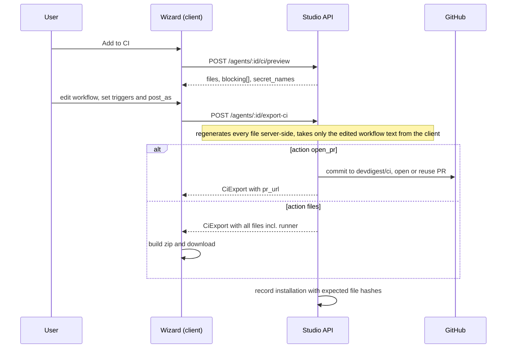
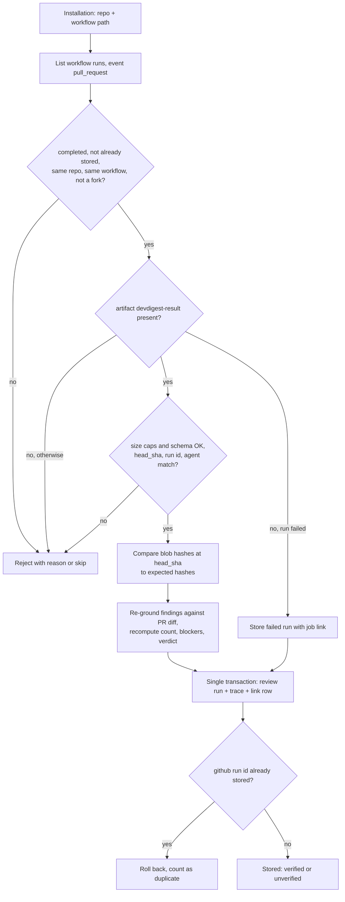

# Spec: Export to CI — deploy a review agent to GitHub Actions, ingest CI runs back into the studio

**Status:** draft · **Date:** 2026-10-11 · **Scope:** cross-module — `server/` · `client/` · `agent-runner/` · shared contracts (both vendored copies)

Prescriptive spec, derived from the Development Plan
[`docs/plans/export-to-ci.plan.md`](../docs/plans/export-to-ci.plan.md) (the
plan is the source; where this spec and the plan differ, the plan's wording
was read first and this file only restates it). It was written for review
**before implementation starts**. Following this directory's convention
([README](README.md)) it is in English; code identifiers, endpoint names and
enum values are kept verbatim. Feature name in the lesson table: L06 "Export
to CI".

## Sources reviewed

- **Development Plan** `docs/plans/export-to-ci.plan.md` (19 steps, R1–R12,
  Security model, Risks, Open questions). It carries the user's freeform
  requirements ("Export to CI — requirements for worktree B") as R1–R12 and
  the user's answers to the clarifying questions.
- **Five design mockups**, as described in the plan: (1) Target step,
  (2) agent CI tab, (3) Preview step, (4) Configure step, (5) Install step.
  The mockup images themselves were not re-read for this spec; mockup
  content below is only what the plan states.
- Root `CLAUDE.md` and `agent-runner/CLAUDE.md` (runner invariants: mandatory
  grounding, untrusted-data wrapping, verdict and exit code from the
  deterministic gate; the runner's `process.env` reads are a documented
  exception to the secrets rule).
- [`specs/README.md`](README.md) (conventions; no file paths or code in
  specs).

## Goal

From an agent's **CI** tab a user opens an **Export wizard**, previews and
optionally edits the generated files, chooses triggers and how results are
posted, and either:

- gets a pull request on branch `devdigest/ci` in an **imported** repo with
  the agent's manifest, skills, memory, workflow and a bundled runner, or
- downloads the same files as a zip.

Every completed GitHub Actions run of that workflow can then be **pulled back**
into the studio. Each appears as a review run with `source='ci'`, with a
trace, and as a row on a new **CI Runs** page; the agent's CI tab summarizes
installations per repo next to a `Fail CI on` setting.

Why: reviews today run only on the studio host. This lets a team run the same
agent on every pull request in their own CI, and still see the results,
cost and findings in the studio.

## Scope

### In scope

- Export wizard (Target → Preview → Configure → Install), agent **CI** tab,
  **CI Runs** page, sidebar entry.
- GitHub Actions as the only active target.
- Per-agent exported file set, with a manifest and version model.
- Ingest of CI results by **pulling** GitHub Actions artifacts, with a
  hardened trust model.
- Additive contract, DB and trace changes.
- Small additive changes to the existing `agent-runner` package (agent
  selection, memory, richer result artifact).
- Building the runner bundle locally and a CI job for the runner package.

### Out of scope

- CircleCI, Jenkins and Generic CLI generators. Their cards **are shown**,
  disabled, with a "coming soon" badge.
- A push ingest endpoint with a per-installation token (documented as a
  later option "B" in the plan; not built).
- Publishing `devdigest/review-action@v1`; the placeholder is not emitted.
- Pushing the `OPENROUTER_API_KEY` repo secret to GitHub from the studio.
- Providers other than OpenRouter in CI.
- The agent **Stats** tab visible in the mockups.
- The multi-run service (`multi_agent_runs`), the PR feed and the polling
  modules; the existing review execution path is not modified (R10).
- Uninstalling or removing an installation.
- Server-side background (cron) sync: sync is user-triggered or triggered by
  the client while a CI view is open.
- A new e2e journey (hermetic e2e cannot reach GitHub).

## Decisions already made

| Decision | Consequence |
|---|---|
| Ingest by **pull** through GitHub Actions artifacts (user may veto the Security model, see below) | The studio needs only its existing GitHub token plus Actions read; no public endpoint, no new secret |
| `agent-runner` already exists and is **built locally**; the studio reads the built bundle | If the bundle is missing, Preview and Install return 409 with the build command; the studio never builds on demand. The dev bootstrap script builds it when missing |
| Workflow file is `.github/workflows/devdigest-review-<agent-slug>.yml` (not the mockup's `devdigest-review.yml`) | Several agents can share one repo without overwriting each other's workflow |
| Runner file is `.devdigest/runner.mjs`; extension is confirmed against the real bundle format during implementation (falls back to `.cjs` if the bundle turns out to be CommonJS) | A target repo without `"type":"module"` still loads it as ESM |
| Generated workflow pins **Node 22** (mockup says 20, which is end-of-life) | One constant to change if 20 is preferred |
| All four target cards render as in the mockup; only **GitHub Actions** is selectable | No generators exist for the other three |
| Additive edits to `agent-runner` source are allowed | Needed for agent selection, memory and trace fields; old installed bundles keep working |
| Multi-agent execution of the plan | Implementer, test-writer, architecture and security reviewers, plan verifier |
| `Fail CI on` is a 3-value segmented control (`critical` / `warning` / `never`); `any` stays Config-tab-only | An agent already set to `any` shows a fourth read-only selected pill |
| OpenRouter-only in CI; the wizard blocks Install for other providers | Anthropic/other agents get a `provider_unsupported` block |
| Memory file holds global memory plus repo-scoped memory of the target repo | |
| Repo picker lists imported repos only | A non-imported repo gives `repo_not_imported` |
| The zip is built client-side and **still records an installation** | Zip installs appear in the CI tab but have no PR link |
| Each CI run writes a review run with `source='ci'` | |
| Fork PRs are skipped | By the workflow condition and again at ingest |
| Tests: server unit + integration, runner unit, client component tests; no new e2e | |

## Export flow

## User-facing behaviour

### Entry points

The agent editor gets a new **CI** tab. **Add to CI** (and the dashed
**Add repository** row) opens the wizard as a modal over the page. The
wizard has four steps with the existing step indicator: Target, Preview,
Configure, Install. Local wizard state: step, target, repo, triggers,
`post_as`, edited workflow text, install action.

### Step 1 — Target (mockup 1)

- 2×2 grid of four cards with their descriptions: GitHub Actions, CircleCI,
  Jenkins, Generic CLI.
- GitHub Actions is selected and carries the "recommended" badge.
- The other three are dimmed, not selectable, not focusable as options,
  and show a "coming soon" badge.
- Below the grid, a repo picker over **imported** repos only. It defaults to
  the shell's active repo; if none is exposed, to the first repo.

### Step 2 — Preview (mockup 3)

- The preview is requested on entering the step and again whenever repo,
  triggers or `post_as` change.
- Left: "FILES TO CREATE" list. Right: a viewer of the selected file.
- Exported files per agent (see [Exported file set](#exported-file-set)):
  manifest, one file per enabled linked skill, memory, workflow, runner.
- Only the **workflow** is editable (monospace textarea with an "editable"
  chip). "Reset to generated" discards edits.
- The runner row reads "generated bundle · <size> · not editable" and its
  content is not shown or shipped to the browser for preview.
- Any `blocking[]` entry renders an error banner and disables Continue.
  Codes: `provider_unsupported`, `runner_bundle_missing`,
  `repo_not_imported`, `target_unsupported`.
- The preview also tells the user which secret to create:
  `OPENROUTER_API_KEY`.

### Step 3 — Configure (mockup 4)

- **Triggers** (chips): `opened` and `synchronize` on by default,
  `reopened` optional; at least one must stay selected.
- **Post results as** (radios): `github_review` (recommended) /
  `pr_comment` / `none` (exit code only).
- The info note from the mockup is shown.
- If the user already edited the workflow, changing triggers or `post_as`
  asks for confirmation ("regenerate workflow? your edits will be lost")
  before the edit is cleared.
- The stale pre-scaffolded "block merge" copy is replaced by the mockup's
  required-status-check note.

### Step 4 — Install (mockup 5)

- Two option cards: **Open a PR with these files** (recommended; shows repo
  and file count) and **Copy files as a zip** (labelled "add them
  manually").
- A note about the `OPENROUTER_API_KEY` secret and a "GitHub Action setup
  docs" link to GitHub's secrets documentation.
- **Install** with the PR option: success state with a "View pull request"
  link. With the zip option: the server returns every file, including the
  runner, and the client downloads `devdigest-ci-<slug>.zip`.
- Errors (missing scope, missing GitHub token, 409 with `blocking`) render
  inline in the wizard.
- The wizard never writes to the default branch; it only uses `devdigest/ci`
  (R6). If a PR for that branch is already open it is reused.

### Agent CI tab (mockup 2)

- Header "CI deployment" with an "Active in N repos" badge.
- **Update CI config** (re-commits the regenerated files to `devdigest/ci`
  for every PR-based installation of the agent; disabled when there are
  none; shows progress and a result toast) and **Add to CI** (primary).
- **Fail CI on** card: segmented control `Critical` / `Warning+` / `Never`
  writing the agent's `ci_fail_on` through the existing agent update route
  (no new route). Changing it makes installed manifests "outdated".
- One row per installation: repo, target badge "GitHub Actions", last-run
  status and relative time, link to the open PR, an **Update available**
  badge when `outdated`, and a warning badge when the last run was
  `unverified`. Workflow and manifest versions appear as secondary text.
- A history list of the last 5 runs with a link to the CI Runs page
  filtered by this agent.
- While the tab is mounted the client auto-syncs on mount and every 120 s
  while the page is visible.
- Installation is `outdated` when the agent version differs from the
  exported manifest version, when the regenerated manifest differs from the
  stored one by hash, or when the current runner bundle differs by hash.

### CI Runs page

- New page at `/ci-runs`, new sidebar group **GLOBAL** with one item "CI
  Runs", placed after the existing SKILLS LAB group.
- Title, subtitle, an "auto-refresh on" indicator (same auto-sync as above)
  and a **Refresh** button that syncs and toasts a summary of ingested and
  rejected counts.
- Filters: last N days (default 7, max 90), agent, repo, status, mirrored
  to URL search params (the CI tab link uses `agent_id`).
- Columns: timestamp, repository, pull request (`#n`, to the studio PR page
  if imported, otherwise to GitHub), agent (to its CI tab), verdict chip
  (`REQUEST_CHANGES` / `COMMENT` / `APPROVE`), findings (re-grounded count,
  tooltip "CI reported N" when different), cost and duration (tooltip
  "reported by CI"), status with an `unverified` warning badge, and a "View
  job" external link (opened with `rel="noopener noreferrer"`).
- Empty state with the existing empty copy. At most 200 rows are returned.

## Exported file set

For each agent × repo installation, all paths are flat and none lies under
the repo's `.devdigest/specs|docs|insights/` directories (the studio's
project-context scanner treats those as repo documents).

| Path | Role | Notes |
|---|---|---|
| `.devdigest/agents/<slug>.yaml` | `manifest` | Built from the agent, validated by the **same** `AgentManifest` schema the runner uses, then round-tripped to prove it parses back identically. Header comment records the agent version |
| `.devdigest/skills/<slug>.md` | `skill` | One per enabled linked skill, in the order a studio run injects them |
| `.devdigest/memory.jsonl` | `memory` | One JSON object per line: global memory plus repo-scoped memory for the target repo |
| `.github/workflows/devdigest-review-<agent-slug>.yml` | `workflow` | The only file the user can edit before install |
| `.devdigest/runner.mjs` | `runner` | The locally built bundle; excluded from the diff the model sees (the runner already strips `.devdigest/` paths) |

Generated workflow, in behavioural terms:

- Triggers: `pull_request` with the chosen types.
- `permissions`: `contents: read`, `pull-requests: write`; checkout without
  persisted credentials.
- The job runs only when the PR head repo equals the base repo (fork PRs are
  skipped) and has a 15-minute timeout.
- Node 22; runs the bundled runner with `review --agent <slug>`.
- Environment: `OPENROUTER_API_KEY` and `GITHUB_TOKEN` from secrets,
  `PR_NUMBER`, and `DEVDIGEST_POST_AS` (so `post_as` is not a manifest
  field). With `none` the token stays (the runner still needs it to read
  the diff).
- Always uploads artifact `devdigest-result` (file `devdigest-result.json`,
  14-day retention, missing file tolerated).

Server-side rules at export: only the edited workflow text is taken from the
client (validated: parses as YAML, ≤ 20 000 chars, still invokes this
agent's runner; a removed upload step yields a warning, not an error). Every
other file is regenerated by the server; client-supplied paths or contents
for them are never accepted; every path is checked against an allow-list.

## Manifest and versioning model

| Item | Meaning | Where it is recorded |
|---|---|---|
| Manifest version | The agent's integer version at export (optional field, so old manifests still validate) | Installation, result artifact, run trace |
| Manifest hash (sha256) | Detects that the studio's agent now differs from what is installed | Installation, artifact, trace |
| Workflow template version | Version of the studio's workflow template (starts at 1) | Installation |
| Runner version and hash | Runner artifact format version (v2 here) / bundle hash | Installation, artifact, trace |
| Expected blob hashes | Git blob SHA of every generated file at export time | Installation (used for verification at ingest) |
| Dependencies | Versions of the runner and review engine that produced a result | Artifact and trace |

Re-export for the same agent and repo updates the existing installation
(unique per agent+repo). A skills-only change does not bump the agent
version (existing behaviour), so `outdated` also relies on the manifest
hash.

## Ingest: pull through artifacts

Sync is single-flight per workspace (concurrent calls share the in-flight
one) and looks at the newest 30 workflow runs per installation. One failing
installation (for example a missing token scope) is reported in the result
and does not abort the others.

### Security model

> Veto point for the user: the plan asks that any unacceptable rule here be
> raised **before** the ingest work starts.

**What GitHub proves vs. what it does not.** Fetching run X with the
studio's own token proves run X happened in repo Y, for workflow file Z, at
commit S, for event E. It does **not** vouch for the artifact content:
anyone with write access can push a branch that edits the workflow or runner
and uploads any `devdigest-result.json`. All rules follow from that.

**Rejection checks** (a rejected run is not stored; it is counted in the
sync result with a reason):

| # | Rule | Reject reason |
|---|---|---|
| I1 | Runs are listed per installation from its own repo and workflow path; the studio never accepts a run id or repo from the client | by construction |
| I2 | Run's repository equals the installation repo (case-insensitive) | `repo_mismatch` |
| I3 | Run's head repository equals the installation repo (rejects fork PRs) | `fork_run` |
| I4 | Event is `pull_request` | `wrong_event` |
| I5 | Run's workflow path equals the installation's | `wrong_workflow` |
| I6 | Run is `completed` (in-progress runs are silently skipped until a later sync) | skipped |
| I7 | Exactly one non-expired artifact `devdigest-result`; zip ≤ 256 KiB; the single entry `devdigest-result.json` ≤ 1 MiB uncompressed, enforced while inflating (zip-bomb guard); no other entries read | `artifact_missing` / `artifact_too_large` |
| I8 | JSON parses and matches the result-artifact schema; at most 500 findings | `artifact_invalid` |
| I9 | Artifact `head_sha` equals the run's; `github_run_id` equals the run id when present; `agent_slug` equals the installation's | `artifact_mismatch` |
| I10 | Idempotency: unique GitHub run id, inserted in the same transaction as the review run; a re-sync never duplicates | skipped, `duplicate` |

A run that passes I1–I6 but has **no artifact and conclusion `failure`** is
stored as a failed run with the job link (the runner's hard-fail path writes
no artifact).

**Content trust** (stored, but flagged):

- **V1 Verification.** Every generated file's git blob SHA is recorded at
  export. At ingest the studio fetches the blob SHAs of the same paths at
  the run's `head_sha`. All equal → `verification='verified'`; otherwise
  `'unverified'` with a warning badge, and an unverified run does not count
  toward the CI tab's "succeeded" state. Known false positive: the
  `pull_request` event checks out the merge ref, so if the exported files
  changed on the base after the PR branched, the run is flagged. UI wording
  must be "config differs from installed version", not "tampered".
- **V2 Untrusted findings.** Findings are stored and rendered as plain text
  only (no raw HTML; Markdown only through the existing Markdown
  primitive). When `base_sha` is present the studio fetches the compare diff
  and re-runs grounding: findings that fail are dropped; count and
  `grounding` are recomputed; the CI-reported count is kept only in the
  trace. If the diff is unavailable or over 2 MiB, findings are kept and
  `grounding` reads `'not rechecked'`. Blockers and the stored verdict are
  recomputed from the agent's current `ci_fail_on` — the artifact's own
  verdict is never trusted for display.
- **V3 Cost and duration** are self-reported, labelled "reported by CI",
  informational only.

**Token and secrets.**

- Only the studio's existing GitHub token is used (kept in the secrets
  store, never in config, DB, logs, generated files or the artifact). Scopes
  needed: Contents read/write, Pull requests read/write, **Workflows write**
  (GitHub refuses commits under `.github/workflows/` without it), Actions
  read. A 403/404 is mapped to an error naming the missing scope, never the
  token. A missing token gives "Connect GitHub in Settings → API Keys".
- No ingest token is created, so there is no new secret.
- The generated workflow references only `secrets.OPENROUTER_API_KEY` and
  the automatic `secrets.GITHUB_TOKEN`.

## Contract, DB and trace changes (additive only)

Contract changes live in the shared contracts and must be mirrored
byte-for-byte to the client copy.

| Area | Change | Consequence |
|---|---|---|
| New schemas | `CiTrigger` (`opened` / `synchronize` / `reopened`), `CiPostAs` (`github_review` / `pr_comment` / `none`), `CiPreviewInput`, `CiPreview`, `CiAgentOverview`, `CiRunsQuery`, `CiSyncResult` | New endpoints have typed requests/responses |
| `AgentManifest` | + optional `version` | Old manifests still validate |
| `CiExportInput` | `triggers` becomes an enum array, min 1, default `['opened','synchronize']`; + optional `workflow_yaml`; `base` optional (service resolves the default branch) | The only narrowing; the plan states nothing consumes it yet and requires re-verifying that first |
| `CiFile` | + `role`, `size_bytes` | Preview can show roles and sizes; runner content omitted from preview |
| `CiInstallation`, `CiRun` | + nullish fields (repo, post_as, triggers, versions, hashes, branch, `pr_url`, `outdated`, `last_run`; run: agent, verdict, duration, job URL, head SHA, model, `verification`, `grounding`, reported findings count, …) | |
| `CiResultArtifact` | + v2 fields (`format: 'devdigest-ci-result/v2'`, slug, manifest version/hash, provider, model, runner and Node versions, dependencies, repo, SHAs, run id/attempt, verdict, blockers, gate result, `post_as`, tokens, findings); existing required fields stay required | v1 artifacts still parse |
| `RunTrace.config` | + nullish `commit_sha`, `base_sha`, `manifest_sha256`, `runner_version`, `dependencies`, `ci_job_url`, `verification` | Fields only added, never retyped |
| GitHub and runner-bundle ports | New operations: list workflow runs, list run artifacts, download one artifact file under size limits, get blob SHAs, get compare diff, get default branch; a new port for reading the runner bundle | Mocks provided; no live GitHub in tests |
| DB (one generated migration) | Installations gain repo link, agent slug, post_as, triggers, workflow path/YAML/version, manifest version/hash, runner version/hash, expected blobs, branch, PR URL, timestamps; unique per agent+repo. Run link table gains review-run link, GitHub run id/attempt, repo, head SHA, job URL, verdict, verification, duration, reported count; unique GitHub run id | Columns and indexes only added; nothing dropped or renamed. Both tables are empty today |

### API surface

| Endpoint | Purpose |
|---|---|
| `POST /agents/:id/ci/preview` | Generate preview and `blocking[]` |
| `POST /agents/:id/export-ci` | Open/reuse PR or return files for the zip; rate-limited (6/min); `201` |
| `POST /agents/:id/ci/update` | "Update CI config" for PR installations |
| `GET /agents/:id/ci` | CI tab overview |
| `GET /agents/:id/ci/runner` | Runner bundle for the zip path; 409 if missing |
| `GET /ci/runs` | CI Runs list with filters |
| `POST /ci/sync` | Pull and ingest; rate-limited (12/min) |

### Trace fields

A CI-sourced run stores a trace with: agent name, agent (manifest) version as
string, provider, model, PR, `source: 'ci'`, commit SHA, base SHA, manifest
sha256, runner version, dependencies, CI job URL, verification result, and
the stats from the artifact. The assembled prompt is **not** transmitted
from CI, so it is stored empty; tool calls, raw output, memory-pulled and
specs-read are empty. The log holds one line per verification and grounding
decision.

## Runner changes (additive)

- Optional `review` subcommand and `--agent <slug>` (env `DEVDIGEST_AGENT`
  fallback) selects `agents/<slug>.yaml`; without it the existing
  "exactly one manifest" rule is unchanged.
- Loads `.devdigest/memory.jsonl` (missing → none; invalid lines skipped;
  capped at 200 items) and passes it into the review.
- Reads head/base SHA from the event payload and run id/attempt from env.
- Result artifact gains the v2 fields above. Grounding, the deterministic
  gate (verdict and exit code from `ci_fail_on`, never the model's
  verdict), untrusted-data wrapping and the hard-fail behaviour are
  unchanged.
- Old installed bundles keep working until the user runs "Update CI
  config".

## Requirements and acceptance criteria

| Req | Requirement | Acceptance criteria |
|---|---|---|
| R1 | **Add to CI** opens a 4-step wizard: Target → Preview → Configure → Install | The wizard is a modal with the four labelled steps; Back/Continue move between them; it can be opened from the CI tab and from "Add repository" |
| R2 | Target: GitHub Actions primary; other targets only with real generators (user decision: show disabled + "coming soon") | Four cards render; GitHub Actions is selected with a recommended badge; the other three are `aria-disabled`, non-selectable, show "coming soon"; a non-`gha` target in a request yields `target_unsupported` |
| R3 | Preview shows manifest, skills, `.devdigest/memory.jsonl`, editable workflow | Preview lists manifest, enabled skills, memory, workflow and runner; only the workflow is editable; runner content is not sent to the browser; a blocking entry disables Continue |
| R4 | Configure: triggers `opened` / `synchronize` / optional `reopened`; post as review / PR comment / exit code only | Defaults are `opened` + `synchronize`; at least one trigger is required; the three `post_as` options exist; the generated workflow's trigger types and `DEVDIGEST_POST_AS` match the choice; changing them after an edit asks for confirmation |
| R5 | Install: open a PR with the files, or download a zip | PR option commits and opens/reuses a PR and shows `pr_url`; zip option returns all files incl. runner without any GitHub call and downloads a zip; both record an installation |
| R6 | Writes only to its own `devdigest/ci` branch and opens a PR, never to `main` | Commit calls target branch `devdigest/ci` only, never the base branch; an existing open PR for that branch is reused |
| R7 | The workflow runs the bundled `agent-runner`; the `devdigest/review-action@v1` placeholder is not emitted | The workflow runs `.devdigest/runner.mjs review --agent <slug>`; no `uses: devdigest/review-action` appears; if the bundle is missing, Preview and Install return 409 with the build command; the dev bootstrap builds the bundle; a CI job typechecks, tests and builds the runner |
| R8 | CI Runs page: repo, PR, agent, verdict, findings, cost, duration, job link | The page lists those columns with filters (days, agent, repo, status), an empty state, a unverified badge, and a working job link; `GET /ci/runs` filters work and are workspace-scoped |
| R9 | Agent CI tab: installations, workflow version, history, `Fail CI on` | The tab shows installation rows with versions, last run and `outdated` / `unverified` badges, a 5-item history, and the `Fail CI on` control (`any` rendered read-only when set) |
| R10 | Touch only the CI module, its routes, CI Runs and the agent CI tab; leave the multi-run service and PR feed alone | No diff in the review executor, `multi_agent_runs`, pulls/polling modules or the PR feed; the only other edits are the explicitly listed additive ones (runner, nav, shared contracts, docs, bootstrap script) |
| R11 | Ingest writes review runs with `source='ci'` and accepts results only through an authenticated or verified channel | Sync obeys I1–I10 and V1–V3; two syncs of the same run give exactly one review run, one trace and one link row; forged or mismatched artifacts are rejected with the stated reason; no secret reaches DB, logs, files or the artifact |
| R12 | Manifest validated by the same schema in studio and runner; trace stores manifest version, model, deps, commit SHA | The generated manifest round-trips through the shared manifest schema; the stored trace has manifest version, model, dependencies and `commit_sha` set |

## Verification hint

Per the plan's test strategy (typological, per `TESTING.md`): server unit
(manifest round-trip, workflow content, slug and path safety, a known git
blob SHA vector, one test per reject reason, duplicate, oversized zip,
unverified, re-grounding, failed-run-without-artifact, one installation
failing without aborting others); server integration (preview, export for PR
and files, double sync, filters, workspace isolation, all LLM providers
overridden); runner unit (`--agent`, memory, v2 artifact, hard-fail);
client component tests (wizard steps, disabled targets, blocking, confirm on
regenerate, zip, `Fail CI on` mapping, CI Runs table). No live GitHub or
LLM, no new e2e.

## Known risks

| Risk | Mitigation (from the plan) |
|---|---|
| **Nav conflict**: the parallel multi-agent-review worktree (`emdash/multi-agents-review-qyvmj`) likely also adds a GLOBAL group in the sidebar config and the shell messages | Keep the GLOBAL edit to one item; call it out in the PR description |
| **PAT scopes**: the studio's GitHub token may lack Workflows write or Actions read, so commit or sync returns 403/404 | Scope-specific error messages; per-installation sync failures are isolated |
| **Fork PRs**: secrets are unavailable and artifacts untrusted | Workflow skips forks; ingest rejects `fork_run` |
| Forged artifact on a branch by a write-access user | V1 marks it `unverified`; V2 re-grounds and recomputes blockers |
| `unverified` false positives when exported files changed on the base after the PR branched | Wording "config differs from installed version" |
| Bundle format mismatch (`.mjs` vs CommonJS) | Format is checked on the real bundle before the file name is final |
| Zip bomb / huge artifact | Streamed zip cap, per-entry size filter, JSON cap, findings cap |
| Two agents in one repo share `devdigest/ci`: one open PR collects both agents' files; a shared skill file is rewritten by the last export | Per-agent manifest and workflow paths; `outdated` flags drift |
| Unique agent+repo index fails if some dev DB already has installation rows | Nothing writes the table today; check the row count before migrating |
| Runner changes affect already-installed bundles | All changes additive; v1 artifacts still parse |

## Open for review

Please double-check these before implementation starts:

1. **Language.** This file is English because [README](README.md) requires
   specs to be written in English; the request asked for Ukrainian unless the
   README says otherwise. A Ukrainian copy can be produced if you want one for
   review.
2. **Mockups.** Mockup content here is only what the plan describes; the five
   images were not re-read.
3. **Workflow filename** `devdigest-review-<agent-slug>.yml` instead of the
   literal `devdigest-review.yml` (plan open question 1).
4. **Node 22** instead of the mockup's 20 (plan open question 2).
5. **Runner bundle source**: built locally and read by the studio, not
   committed to git (plan open question 3).
6. **Runner ownership**: this spec allows additive edits to `agent-runner`
   source; confirm worktree B may make them (plan open question 4).
7. **Security model** (ingest rules I1–I10, V1–V3), including the
   documented false positive for `unverified`, is the part the plan marks as
   your veto point.
8. **Narrowing of `CiExportInput.triggers`**: the only non-additive contract
   edit; the plan relies on no current consumer and requires verifying that
   first.
9. **Zip installs** record an installation but have no PR and cannot be
   updated through "Update CI config" (only PR-based ones are).
10. **Out-of-scope gaps**: no uninstall, no background sync, no push ingest
    (all stated in the plan's Out of scope).
