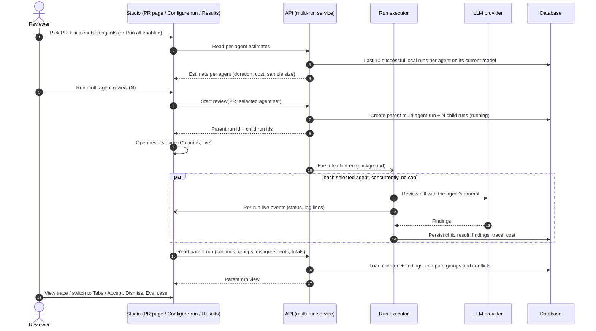
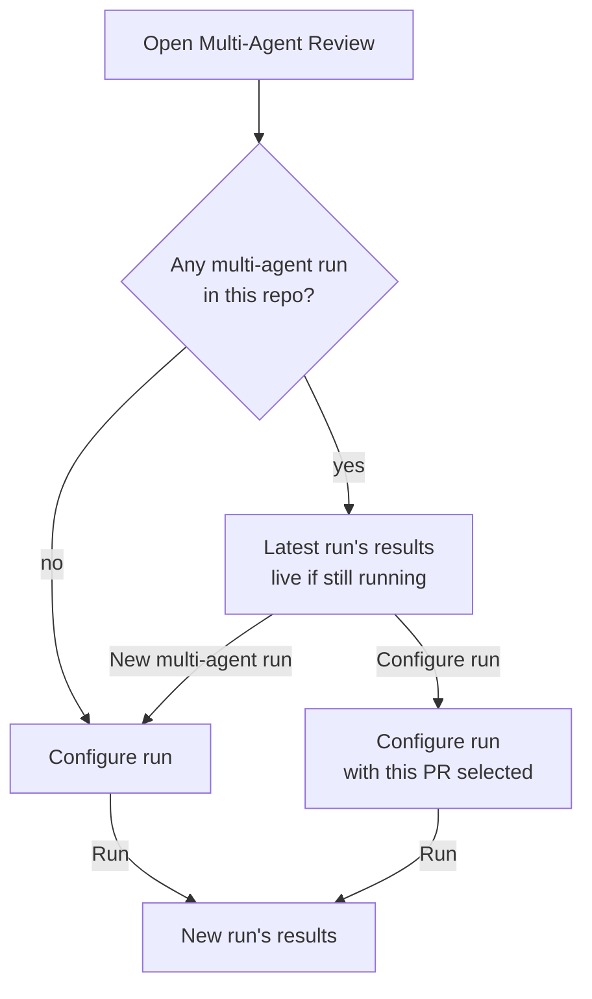
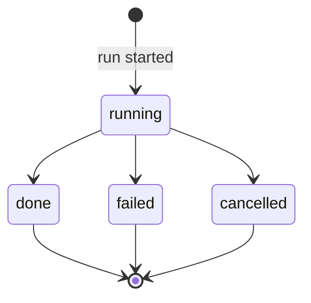

# Spec: Multi-Agent Review with live per-agent statuses (worktree A)

**Status:** draft (revised with user answers) · **Date:** 2026-10-10 · **Scope:** cross-module — `server/` · `client/` · shared contracts

> Written in plain English (repo convention for specs). Terms the UI shows
> verbatim are in `code` font so they can be matched against the mockups.

## Sources reviewed

**Requirement (translated from the Ukrainian original):** one PR can carry
security risks, performance problems and domain-rule violations at the same
time. Several specialised reviewers give wider coverage, but only if the
product removes duplicates, shows disagreements and does not hide the cost.
Worktree A must deliver:
- an agent picker on the PR page and a **Configure run** screen: pick a PR, tick agents, see a time/cost estimate based on past runs, and press `Run multi-agent review (N)`;
- parallel execution through the existing `POST /pulls/:id/review` endpoint and the run executor, with the UI only passing the selected agent set;
- grouping of runs through `multi_agent_runs`, so that the individual `agent_runs` belong to one parent run;
- grouping of findings with the existing heuristic, without losing the original findings or their attribution;
- a **Where agents disagree** block that shows each agent's verdict for one code location, including `did not flag`, plus a `Show only conflicts` toggle;
- a results page with two modes: **Columns** with live statuses, and **Tabs + detail** with `confidence`, `suggested fix`, `Accept`, `Dismiss`, `Learn` and `Turn into eval case`;
- reuse of the existing live-log stream and run-trace drawer, with each column having its own status and `View trace` link;
- worktree A is limited to the PR page, Multi-Agent Review and the multi-run service with its new parts. `ci/` and `agent-runner/` are not changed.

**User decisions, round 1 (with the request):**
- `Reply to author` (mockup 6) is out of scope.
- `Configure agents...` in the PR-page dropdown opens Configure run, with the PR already selected.
- `Accept`, `Dismiss`, `Learn` and `Turn into eval case` are available in both modes: on the expanded card in Tabs + detail, and on each finding in Columns, so a decision needs no navigation. Clicking a finding in Columns still opens it in Tabs + detail.

**User decisions, round 2 (answers to the first draft's open questions):**

| Topic | Decision | Where it now lives |
|---|---|---|
| Estimates | Based on the last 10 successful **local** runs per agent across the workspace, on the agent's **current model** only. CI runs never count. No matching runs means "no estimate". | FR-6 |
| `did not flag` note | One fixed generic note, the same for every agent. | FR-14 |
| `Learn` | The button is displayed but does nothing in this feature. Its real behaviour is a later follow-up. | FR-17, Out of scope |
| Card description | The agent's latest summary on this PR. | FR-4 |
| Grouping rule | Same file and overlapping line ranges. Category is ignored and there is no line tolerance. An agent with several findings in a group is shown with its highest severity. | FR-12 |
| Repeat runs | Only the latest multi-agent run per PR is shown. The Multi-Agent Review area opens on the latest run, with a button to start another. | FR-22, FR-23 |
| Cost of failed agents | Shown separately in the totals. | FR-10 |
| Concurrency | All selected agents run at once, with no cap and no queued state. | FR-8, NFR-3 |
| Which agents are listed | Disabled agents are never listed. Enabled agents start ticked. The run button is disabled with no PR or with 0 agents ticked. | FR-1, FR-3, FR-4 |
| PR-page dropdown | The picker replaces the per-agent single-run items. An explicit "Run all enabled" stays and keeps working. | FR-1, FR-21 |
| Agents outside the run | They never appear anywhere on the results page. | FR-13 |

**Design mockups (6 PNGs):**
1. The PR page with the `Run Review` dropdown open.
2. Configure run, empty state.
3. Configure run with a PR chosen and 5 agent cards.
4. Configure run with the PR dropdown open.
5. Results in Columns mode.
6. Results in Tabs + detail mode.

Where the mockups and this spec differ, see *Mockup deviations*.

**Existing specs checked for overlap:**
- [`04-eval-pipeline.md`](04-eval-pipeline.md) FR-1 / AC-1–AC-3: `Turn into eval case` is enabled only after an accept or dismiss decision. This spec reuses that rule.
- [`server/specs/pr-cost-and-findings.md`](../server/specs/pr-cost-and-findings.md): a PR's cost counts successful runs only. This spec keeps that rule for the PR list. The multi-agent totals add failed-run cost as a **separate** figure and never fold it into the PR cost.
- [`01-conventions.md`](01-conventions.md), [`02-project-context.md`](02-project-context.md), [`03-pr-brief.md`](03-pr-brief.md): no overlap.

**INSIGHTS.md entries that shaped this spec:**
- `server/INSIGHTS.md` 2026-09-19: a review row exists only for a successful run. A failed agent has no findings, so it must not be shown as "did not flag".
- `server/INSIGHTS.md` 2026-09-21: a dedupe key must never include text a user can edit. The precedent keys on category + path + line. The grouping rule here keys on physical location only.
- `server/INSIGHTS.md` 2026-09-21: a stats denominator must exclude rows created before the feature existed. This shaped the estimate sample filter.
- `server/INSIGHTS.md` 2026-09-29: a run trace can be added to, never retyped.
- `client/INSIGHTS.md` 2026-09-29: the trace drawer content is reused as it is.

**What exists today.** Two `researcher` subagents plus direct reads checked each part the requirement calls "ready":

| Requirement calls it ready | Actual state | Citation |
|---|---|---|
| Parallel execution through `POST /pulls/:id/review` and the run executor | **Partly.** The endpoint is async, returns run ids at once and creates one run per agent, each created as running. But it accepts only *one* `agentId` or `all: true`, **not a list**. The executor runs agents **one after another, not in parallel**. Per-agent failures are isolated and per-run cancel works. The only timeout is the LLM client's 90s per request. | `server/src/modules/reviews/routes.ts:29-49`; `server/src/vendor/shared/contracts/platform.ts:301-304`; `server/src/modules/reviews/run-executor.ts:122,149-160`; `reviewer-core/src/llm/openrouter.ts:54` |
| `multi_agent_runs` groups `agent_runs` | **Table only.** It has columns for id, workspace, PR and run time. `agent_runs` has **no link** to it, and no code reads or writes it. | `server/src/db/schema/runs.ts:9-37,78-87` |
| Multi-agent result contract | **Defined but never served.** It describes per-agent columns (status done, failed or running) and conflicts (each take is a severity or `ignored`, plus a note). The endpoints named in its comment do not exist. | `server/src/vendor/shared/contracts/observability.ts:22-86` |
| Finding-grouping heuristic | **Does not exist for review findings.** The only related logic merges partial results within one run, with no dedup. The precedent is the Conventions dedupe key. | `reviewer-core/src/review/reduce.ts:43-55`; `server/src/modules/conventions/helpers.ts:259-295` |
| Time and cost estimate from past runs | **Missing.** Each run stores duration, tokens, cost, model, status and source (local or CI). Nothing computes per-agent averages. | `server/src/db/schema/runs.ts:9-37`; `server/src/modules/reviews/service.ts:75-85` |
| Live log stream | **Exists, as one stream per run.** The bus that feeds it is in-memory and lives in one process. The client hook merges several runs into **one unlabeled list**. | `server/src/modules/reviews/routes.ts:53-97`; `server/src/platform/sse.ts`; `client/src/lib/hooks/reviews.ts:304-352` |
| Run-trace drawer | **Exists, scoped to the PR page.** It has Trace and Log tabs. | `client/src/app/repos/[repoId]/pulls/[number]/_components/RunTraceDrawer/RunTraceDrawer.tsx:19-114`; `server/src/modules/reviews/routes.ts:128-133` |
| `Accept`, `Dismiss`, `Turn into eval case` | **Exist.** They are keyed on the finding id. | `server/src/modules/reviews/routes.ts:150-156`; `server/src/modules/eval/routes.ts:75-104` |
| `Learn` | **Missing.** It is in the action enum and has UI copy, but there is no route or UI. | `server/src/vendor/shared/contracts/findings.ts:82`; `server/src/modules/reviews/findings.ts:31-32` |
| PR-page picker | **Single-select.** It offers "Run all enabled", one item per agent (disabled agents included and marked), and "Configure agents". | `client/src/app/repos/[repoId]/pulls/[number]/_components/RunReviewDropdown/RunReviewDropdown.tsx:54-82` |
| Multi-Agent Review page and nav | **Missing.** Only a nav-key mapping and copy strings exist. | `client/src/components/app-shell/helpers.ts:28`; `client/messages/en/shell.json:26`; `client/src/vendor/ui/nav.ts:23-48` |
| Agent icon and colour | **Missing.** The agent record has a description but no icon or colour. | `client/src/vendor/shared/contracts/knowledge.ts:287-302` |
| `ci/`, `agent-runner/` | **Do not exist in this repo**, so the constraint is met trivially. | repo root listing |

## Goal

A reviewer can pick a PR and any set of enabled agents, see roughly how long
the run will take and what it will cost, and start them all at once as **one
grouped multi-agent run**. While the agents work, each one shows its own live
status, log and trace. When they finish, each agent's findings appear side by
side. Findings at the same code location are grouped without losing which
agent said what. Disagreements are listed explicitly, and the full cost is
always visible, including money spent on agents that failed. Returning to
Multi-Agent Review always shows the latest result.

## User stories

- **US-1:** As a reviewer on a PR page, I want to tick several agents and start them with one click, so that I get wider coverage without starting runs one by one.
- **US-2:** As a reviewer, I want a Configure run screen where I pick a PR and agents, so that I can start a multi-agent review from anywhere.
- **US-3:** As a reviewer, I want an estimated duration and cost before I start, based on how these agents behaved recently, so that the price is never hidden.
- **US-4:** As a reviewer, I want each agent's status, log and trace to update live, so that I know which agent is slow or broken.
- **US-5:** As a reviewer, I want the agents' runs to belong to one parent run, so that I can come back to the result as one unit.
- **US-6:** As a reviewer, I want findings at the same code location grouped across agents while still seeing who raised each, so that duplicates don't inflate the picture.
- **US-7:** As a reviewer, I want to see where agents disagree, including an explicit `did not flag`, so that I can judge contested spots.
- **US-8:** As a reviewer, I want to inspect one agent's findings in detail and act on them, so that the multi-agent result feeds the same feedback loop as a single review.
- **US-9:** As a reviewer opening Multi-Agent Review, I want to land on the latest result, with an obvious way to start another run, so that I don't start from a blank form every time.
- **US-10:** As a reviewer used to "Run all enabled", I want that one-click action to keep working, so that the new picker doesn't slow down my usual flow.

## Functional requirements

| ID | Requirement | Story | Acceptance criteria |
|---|---|---|---|
| FR-1 | The PR page's `Run Review` dropdown shows a multi-select picker. It has a `PICK AGENTS TO RUN` heading, a `Clear` action, one checkbox row per **enabled** agent with its estimated duration, a primary button `Run multi-agent review (N)`, the "Run all enabled" action from FR-21, and a `Configure agents...` link. The picker replaces the old one-item-per-agent entries. Enabled agents are ticked each time the dropdown opens. | US-1, US-3 | AC-1: ticking 2 agents shows `Run multi-agent review (2)`. · AC-2: `Clear` unticks all agents, and the count becomes 0. · AC-3: with 0 ticked, the run button is disabled. · AC-4: each row shows `~<seconds>s` from FR-6, or "no estimate". · AC-49: a disabled agent is not listed. · AC-50: when the dropdown opens, every enabled agent is ticked. |
| FR-2 | `Configure agents...` opens Configure run with the current PR selected. | US-1, US-2 | AC-5: clicking it from PR #482 opens Configure run with #482 selected and its agent cards shown. |
| FR-3 | Configure run has two steps. Step 1 is a PR selector. Step 2 is "agents to run". With no PR chosen, step 2 shows `Pick a pull request first`, and the run button is disabled. Configure run can be reached from FR-2, from FR-22's new-run button, from the results page's `Configure run` button, and from the area when no run exists (FR-22). | US-2 | AC-6: with no PR chosen, the empty state shows and the run button is disabled. · AC-7: the selector lists the current repo's PRs as `#<number> · <title>`. · AC-8: choosing a PR replaces the empty state with agent cards. |
| FR-4 | Each agent card on Configure run has: a checkbox; the agent's name, icon and identity colour (`[NEEDS CLARIFICATION: card colour/icon source — see OQ-2]`); a one-line description, which is the **agent's latest summary on the selected PR**, falling back to the agent's configured description when it has never run on that PR; and the estimated duration and cost. Only enabled agents are listed, and all of them start ticked. `Select all` ticks every listed card. | US-2, US-3 | AC-9: `Select all` ticks every card, and the button count equals the card count. · AC-10: each card shows `<seconds>s · $<cost>` from FR-6, or "no estimate". · AC-51: disabled agents are absent, and every enabled agent is ticked when a PR is chosen. · AC-52: an agent that last summarised PR #482 as "N+1 in the user list…" shows that text on its #482 card. An agent with no run on that PR shows its configured description. |
| FR-5 | Next to the run button, Configure run shows the total for the ticked agents: `≈ <duration> · $<cost> · parallel fan-out`. Duration is the **maximum** of the per-agent estimates, because the agents run in parallel. Cost is the **sum**. | US-3 | AC-11: ticked agents at 8.2s/$0.06, 7.4s/$0.05, 6.9s/$0.04 and 7.1s/$0.05 give `≈ 8.2s · $0.20`. · AC-12: if any ticked agent has no estimate, the total is marked as partial, never shown as if it were complete. |
| FR-6 | Each agent's estimate is the average duration and average effective cost (reported cost, or cost derived from model and tokens when none was reported) over that agent's **last 10 successful runs across the workspace**. Only runs that are **local** (not CI) and that used the agent's **current model** count. With zero matching runs the agent shows "no estimate". Estimates are local-only by design. | US-3 | AC-13: past matching runs of 6s and 8s show `~7s`. · AC-14: failed, cancelled and in-flight runs never count. · AC-15: zero matching runs shows "no estimate", never `0s` or `$0.00`. · AC-53: CI runs never affect an estimate. · AC-54: after the agent's model changes, runs on the old model stop counting. With no runs yet on the new model, it shows "no estimate". · AC-68: with 14 matching runs, only the 10 most recent count. |
| FR-7 | Starting a run sends the PR and the **exact set of ticked agents** in one request. The response returns one parent multi-agent run and one child run per agent. After starting from the PR page, the user lands on `[NEEDS CLARIFICATION: landing target after Run from the PR page — see OQ-1; default: the Multi-Agent Review results page for that PR, Columns mode, live]`. Starting from Configure run opens that parent's results page. | US-1, US-2, US-5 | AC-16: ticking 4 agents creates exactly 1 parent run and 4 linked child runs. · AC-17: unticked agents never run. · AC-18: the results page opens before any agent finishes. |
| FR-8 | All selected agents run **concurrently**, with no cap. Today's executor runs agents one after another, so this is new work, not reuse. One agent's failure, timeout or cancellation never stops or fails the others. | US-1, US-4 | AC-19: 4 agents that each take about 7s finish in roughly the slowest agent's time, not the sum. · AC-20: if one agent's LLM call fails, the other 3 still reach `done`. |
| FR-9 | Every child run belongs to exactly one parent run, and each parent belongs to one PR. The parent stays reachable after a reload or restart. | US-5 | AC-21: reloading mid-run restores each column's current status. · AC-22: reloading after completion shows the same columns, findings and totals. |
| FR-10 | The results header shows the PR number and title, `<N> selected agents · parallel`, a `Configure run` button (Configure run with this PR selected), a `Columns` / `Tabs` switch, and a totals line `<N> agents · <total duration> total · $<total cost>`. Total cost covers successful agents. Cost already spent by **failed or cancelled agents is shown separately** next to it, for example "+ $X on failed runs", whenever any is known. | US-4, US-8 | AC-23: the totals update as agents finish. · AC-24: `Configure run` preselects this PR. · AC-25: the chosen mode survives a reload. · AC-55: 3 done ($0.15) and 1 failed with a reported $0.02 shows $0.15 plus a separate "$0.02 on failed runs". A failed agent with no reported cost adds nothing and is not shown as $0.00. |
| FR-11 | **Columns** mode shows one column per selected agent. Each column has: its own live status (running, done, failed or cancelled); name and icon; duration and cost once known; a score ring once done; the findings list (severity icon, title, `file:line`); a findings count; and `View trace`. Clicking a finding switches to Tabs + detail on that agent's tab with the finding expanded. Each finding in Columns also carries Accept, Dismiss, Learn (disabled) and Turn into eval case, with the same rules as Tabs + detail. | US-4, US-8 | AC-26: a running column shows its own live log, and the other columns are unaffected. · AC-27: a failed column shows the reason and no score. · AC-28: clicking a finding opens Tabs + detail on that agent with the finding expanded. · AC-29: each finding in Columns shows Accept, Dismiss, Learn (disabled) and Turn into eval case; acting on one does not leave Columns, and eval case stays disabled until a decision exists. |
| FR-12 | Findings from different agents in one parent run are **grouped by location**. Two findings belong to the same group when they are in the **same file and their line ranges overlap**. Category is ignored, there is no line tolerance, and overlap is transitive within a file. Each group keeps the original findings, each attributed to its agent with its own severity, title, confidence and actions. Grouping never deletes, merges or rewrites an original. An agent with several findings in one group is represented by its **highest severity**. Whether a deduplicated "unique issues" count is shown is `[NEEDS CLARIFICATION: see OQ-4]`. | US-6 | AC-30: two agents flagging the same file and line produce one group with two attributed members. · AC-31: each agent's column and tab still lists its own original finding. · AC-32: accepting one member changes only that member. · AC-56: two findings on the same lines but in different categories fall in one group. · AC-57: findings on lines 52 and 53 that do not overlap fall in separate groups. · AC-58: an agent with a WARNING and a SUGGESTION in one group is shown as WARNING in that group's take. |
| FR-13 | **Where agents disagree** appears below the results in both modes. Each row shows a location (`file:line` and a short title) and one cell per agent that took part: either the agent's severity plus a short note taken from its own finding, or `did not flag`, or "no result" (FR-14). Only agents selected for this parent run appear, both here and anywhere else on the results page. | US-7 | AC-33: a location flagged only by Junior Mentor, in a run with Security and Performance, shows Junior Mentor's severity and `did not flag` for the other two. · AC-34: agents not selected never appear in a row. · AC-59: agents not selected never appear anywhere on the results page (columns, tabs, totals, disagreements). |
| FR-14 | **The `did not flag` rule.** An agent "did not flag" a location only if it took part, **finished successfully**, and has no finding in that location's group. Its cell shows one **fixed generic note, the same for every agent**. Agents never get per-agent explanations for silence. Failed or cancelled agents show a distinct "no result" take. Still-running agents show a pending take. | US-7 | AC-35: a failed agent shows "no result" in every row, never `did not flag`. · AC-36: a running agent's cell shows pending. · AC-60: every `did not flag` cell shows the same note text, whatever the agent or location. |
| FR-15 | `Show only conflicts` is off by default. When off, every grouped location is listed. When on, only **conflicts** are listed. A location is a conflict when at least one successful agent flagged it and at least one other successful agent did not, **or** when the agents that flagged it gave different severities (compared by each agent's highest severity in the group). | US-7 | AC-37: a location flagged by every successful agent at the same severity is hidden when the toggle is on and shown when it is off. · AC-38: WARNING from one agent and SUGGESTION from another is shown when on. |
| FR-16 | **Tabs + detail** mode shows one tab per selected agent, each with the agent's name and score. The active tab shows a summary card (score ring, summary, duration, cost, `View trace`), followed by that agent's findings as expandable cards. An expanded card shows: severity, title, category, `file:line`, confidence as a percentage, rationale, `suggested fix` when present, and the actions `Accept`, `Dismiss`, `Learn` and `Turn into eval case`. | US-8 | AC-39: an expanded finding shows `<n>% conf`, and a `Suggested fix` section when the finding has one. · AC-40: `Accept` and `Dismiss` behave as they do on the PR page. · AC-41: `Turn into eval case` follows `04-eval-pipeline` FR-1. · AC-42: a running agent's tab shows its live status instead of findings. |
| FR-17 | `Learn` appears on every expanded finding in Tabs + detail, but this feature implements **no behaviour** for it. How it looks is `[NEEDS CLARIFICATION: Learn rendering state — see OQ-3; default: visible but disabled, with a "coming soon" tooltip]`. | US-8 | AC-43: `Learn` is visible on every expanded finding, and interacting with it persists nothing and calls no endpoint. |
| FR-18 | `View trace` on every column and on the Tabs summary card opens the existing run-trace drawer for that agent's child run. During the run it opens on that run's live log, and afterwards on its trace. | US-4 | AC-44: on a running agent, the drawer streams only that agent's log. · AC-45: on a finished agent, it shows the stored trace. |
| FR-19 | Live status uses the existing per-run event stream plus run status reads. Each column follows only its own run, so log lines never mix between agents. | US-4 | AC-46: two concurrent agents show two separate logs, each containing only its own lines. |
| FR-20 | The parent run has an overall state, derived from its children: **running** while any child is running; **done** when all children are done; **partial** when at least one child is done and at least one failed or was cancelled; **failed** when every child failed or was cancelled. | US-4, US-5 | AC-47: 3 done and 1 failed shows "partial". · AC-48: all done shows "done". |
| FR-21 | **"Run all enabled"** stays in the PR-page dropdown as an explicit one-click action, next to the picker. It does exactly what the picker does with every enabled agent ticked: it creates one parent multi-agent run for all enabled agents and lands as in FR-7. Clicking it ignores the picker's current ticks. Because disabled agents are never listed (FR-1) and the per-agent items are gone, a **disabled agent can no longer be run from the PR page**. The user must enable it first. | US-10 | AC-61: one click runs every enabled agent and creates one parent run, the same result as ticking all and pressing `Run multi-agent review (N)`. · AC-62: the PR-page dropdown offers no way to run a disabled agent. · AC-69: with 2 of 4 boxes ticked, "Run all enabled" still runs all 4. |
| FR-22 | **Entering Multi-Agent Review** (sidebar entry) shows the **latest multi-agent run of the current repository** when one exists. Its results page has a prominent **"New multi-agent run"** button that opens Configure run. When no multi-agent run exists, the area shows Configure run directly. If the latest run is still in progress, it appears with live columns. | US-9 | AC-63: a repo with no multi-agent run lands on Configure run (FR-3). · AC-64: a repo with runs lands on the newest one, and "New multi-agent run" opens Configure run. · AC-65: when the newest run is in progress, its columns are live. |
| FR-23 | **Only the latest run per PR.** For a given PR, the Multi-Agent Review results show only that PR's newest parent run. Earlier parent runs cannot be browsed here, though their child runs stay in the PR's normal run history. CI runs have no parent multi-agent run and never appear in Multi-Agent Review. | US-5, US-9 | AC-66: after a second multi-agent run on #482, the #482 results show the second run only. · AC-67: a CI review of #482 never appears on the Multi-Agent Review page or in its estimates. |

## Non-functional requirements

| ID | Requirement |
|---|---|
| NFR-1 | **Cost is never hidden.** Every run shown has its cost once known, failed runs' cost is shown separately (FR-10), and an unknown cost is shown as unknown, never as `$0.00`. |
| NFR-2 | **Isolation.** One agent's failure, timeout or cancellation never changes another agent's status, findings or cost. |
| NFR-3 | **No concurrency cap.** Every selected agent starts executing as soon as the run starts. There is no throttled "queued" state. Each child is created directly in the running state. The existing rate limit on starting reviews still applies. |
| NFR-4 | **Live updates** reach the UI within a few seconds of a status change, with no manual refresh. |
| NFR-5 | **Originals preserved.** Grouping and disagreements are computed views. Findings, scores and traces are never modified by them. |
| NFR-6 | **The existing PR page keeps working.** Run history, finding actions and PR cost aggregation on the PR page are not broken. "Run all enabled" keeps its one-click behaviour (FR-21). |
| NFR-7 | **Workspace scoping.** Parent runs, child runs, findings and estimates are visible only inside the workspace that owns them. |
| NFR-8 | **Worktree A boundaries.** Changes are limited to the PR page, the Multi-Agent Review area, the multi-run service and its new parts, and the shared contracts these need. CI and any agent-runner component are out of bounds. |

## Edge cases

- **No enabled agents.** The picker and Configure run show an empty state pointing to agent configuration, and the run buttons are disabled. (AC-3, AC-6, AC-49)
- **No PR chosen** on Configure run. The empty state shows, and the button is disabled. Mockup 2 differs; see *Mockup deviations*. (AC-6)
- **An agent with no matching history** (new agent, model just changed, or only CI runs). It shows "no estimate", and the total is marked partial. (AC-12, AC-15, AC-53, AC-54)
- **The user unticks every agent and then uses "Run all enabled".** All enabled agents run. (AC-69)
- **A disabled agent.** It is never listed and cannot be run from the PR page. (AC-49, AC-62)
- **One agent fails.** Its column is failed with the reason, and the others are unaffected. The parent shows partial. In disagreements the agent shows "no result". Its known cost is shown separately. (AC-20, AC-27, AC-35, AC-47, AC-55)
- **Every agent fails.** The parent run is failed. Instead of disagreement rows, an explanatory empty state is shown. (AC-47)
- **The diff cannot be loaded.** Every child fails with the same reason, and the parent is failed. (AC-27)
- **Reload or navigation away mid-run.** Statuses are restored, and running columns re-subscribe. (AC-21, AC-65)
- **The server restarts mid-run.** Orphaned children are marked failed by the existing reaper, so the parent becomes partial or failed. (AC-47)
- **The live stream is lost.** The column falls back to the stored status and does not hang in running. (AC-21)
- **An agent with zero findings.** Its column shows "no findings", and it shows `did not flag` in every row. (AC-33)
- **Only one agent selected.** One column is shown. The disagreement block is empty, because a conflict needs two successful agents. (AC-37)
- **One agent has two findings at one location.** Both stay in the group, and the agent's take is the higher severity. (AC-58)
- **The rate limit is hit when starting.** An error is shown and no parent run is created. (AC-16)
- **The same PR is run again.** The new parent becomes the one shown, and the older one is no longer browsable here. (AC-66)
- **An action on an original finding.** It affects only that finding. (AC-32)

## Inputs provenance

| Input | Where it comes from | Trust / freshness |
|---|---|---|
| Selected PR | The user, choosing from the repo's imported PRs | Validated server-side against the workspace. May be stale versus GitHub until the next sync. |
| Selected agent set | The user's ticks, or "Run all enabled" | User-controlled. Each id is validated server-side as an **enabled** agent in the workspace. Unknown, foreign or disabled ids are rejected. |
| Per-agent estimate | Last 10 successful local runs of the agent on its current model | Historical and advisory only. Excludes CI runs. |
| Card description | The agent's latest summary on the selected PR, or else its configured description | Summaries are LLM-generated, so they are untrusted text when rendered and may be from an older PR head. |
| Child run status, duration, tokens, cost | Run records written by the executor | Authoritative once finished. Cost may be derived from model and tokens. |
| Live log lines | The per-run in-memory event stream | Ephemeral and lost on restart. The stored trace is the fallback. |
| Findings | LLM output after grounding, which drops findings without a real diff-line citation | The text is untrusted when rendered. Locations are verified against the diff. |
| Disagreement note | Flagged take: the agent's own finding text. `did not flag`: a fixed product string | Finding text is untrusted LLM output. The generic note is static. |
| Agent icon and colour | `[NEEDS CLARIFICATION: see OQ-2]` | — |

## Workflow

Entering the Multi-Agent Review area (FR-22):

Child run status (one per column):

## Service communication

- **Studio to API, over HTTP:**
  - read estimates;
  - start a run (a picked set, or "Run all enabled");
  - read a parent run view;
  - read the latest parent run for the repo and for a PR;
  - read a child run's trace;
  - act on a finding (accept, dismiss, create an eval case).
- **Studio to API, server-sent events:** one subscription per running child. No aggregate per-parent stream exists today. Whether to add one is a planning decision; FR-19 only requires that lines are never mixed.
- **API to executor, in-process:** the start request returns once the parent and child records exist. The children then execute concurrently in the background (FR-8). Today's executor is sequential, so this is a gap to close.
- **Executor to LLM provider:** one review call chain per child, unchanged from single-agent review.

## Contracts

The shared contracts already define a multi-agent run shape and a conflict
shape. Each item marked "new" is a required extension.

- **Start request.** Carries the PR identity and an explicit, non-empty list of agent ids. New: today the request carries only one agent or "all". "Run all enabled" may be expressed as that list or as an "all enabled" flag, as long as the result is identical (AC-61).
- **Start response.** Carries the parent multi-agent run id and, for each agent, its child run id and agent name.
- **Estimate per agent.** Carries the agent id, average duration, average effective cost, and the number of matching runs behind the average, where 0 means "no estimate".
- **Latest-run lookups.** New. One returns the newest parent run of a repository. The other returns the newest parent run of a PR. Each may return "none".
- **Parent run view.**
  - Header fields: parent id, PR number and title, run time, overall state (FR-20), agent count, total duration, total successful cost, and failed-run cost shown separately (new).
  - One column per agent: run id; agent id, name and display attributes; status (running, done, failed or cancelled — the existing shape lacks cancelled); failure reason; score; verdict; summary; duration; cost.
  - The original findings: id, severity, category, title, file, line range, confidence, rationale and suggested fix.
  - Finding groups (new): a location plus member references (agent and finding id).
  - Disagreement rows: a location, a short title, and one take per participating agent. A take is a severity with a note, `did not flag` with the generic note, "no result", or pending. The existing shape has only severity or `ignored`.
  - A conflict flag per row (new).
- **Finding actions.** Unchanged and keyed by finding id: accept, dismiss, create an eval case. This feature adds no new action for `Learn`.

## Traceability

| Requirement | Addressed by |
|---|---|
| FR-1 / AC-1–AC-4, AC-49–AC-50 | Workflow steps 1–5; Estimate contract |
| FR-2 / AC-5 | Area flowchart (Configure run with PR selected) |
| FR-3 / AC-6–AC-8 | Area flowchart; Edge case "No PR chosen" |
| FR-4 / AC-9–AC-10, AC-51–AC-52 | Estimate contract; Inputs provenance "Card description" |
| FR-5 / AC-11–AC-12 | Estimate contract; parallel semantics (FR-8) |
| FR-6 / AC-13–AC-15, AC-53–AC-54, AC-68 | Workflow steps 2–4; Inputs provenance "Per-agent estimate" |
| FR-7 / AC-16–AC-18 | Start request and response; Workflow steps 6–9 |
| FR-8 / AC-19–AC-20 | Workflow `par` block; Service communication (API to executor) |
| FR-9 / AC-21–AC-22 | Parent run view; child state diagram |
| FR-10 / AC-23–AC-25, AC-55 | Parent run view header fields |
| FR-11 / AC-26–AC-29 | Per-agent column contract; child state diagram |
| FR-12 / AC-30–AC-32, AC-56–AC-58 | Finding-group contract; NFR-5 |
| FR-13 / AC-33–AC-34, AC-59 | Disagreement row contract |
| FR-14 / AC-35–AC-36, AC-60 | Disagreement take kinds |
| FR-15 / AC-37–AC-38 | Conflict flag |
| FR-16 / AC-39–AC-42 | Finding fields; existing finding actions |
| FR-17 / AC-43 | Finding actions contract (no Learn action) |
| FR-18 / AC-44–AC-45 | Service communication (per-run stream, trace read) |
| FR-19 / AC-46 | Service communication (per-run streams) |
| FR-20 / AC-47–AC-48 | Parent run view (overall state) |
| FR-21 / AC-61–AC-62, AC-69 | Start request ("Run all enabled" equivalence) |
| FR-22 / AC-63–AC-65 | Area flowchart; latest-run lookups |
| FR-23 / AC-66–AC-67 | Latest-run lookups; Estimate contract (local only) |
| NFR-1 | FR-10; Parent run view cost fields |
| NFR-2 | FR-8, FR-14; child state diagram |
| NFR-3 | Child state diagram (no queued); Service communication |
| NFR-4 | FR-19 |
| NFR-5 | FR-12; Finding groups hold references, not copies |
| NFR-6 | FR-21; additive start request |
| NFR-7 | Inputs provenance (validated PR and agent ids) |
| NFR-8 | Sources reviewed (worktree A boundaries) |

## Verification hint

- **Estimates.** Seed agents with known local runs, CI runs and old-model runs. Check that only the last 10 local runs on the current model count, and that the totals are the maximum of the times and the sum of the costs. (AC-11, AC-13, AC-53, AC-54, AC-68)
- **Fan-out.** Start 4 agents. Check that one parent and 4 children exist, that the children's running intervals overlap, and that the parent finishes in about the slowest agent's time. (AC-16, AC-19)
- **"Run all enabled".** Compare it with "Select all" plus Run. Both should give the same parent run shape. Ticks must be ignored. Disabled agents must not be runnable. (AC-61, AC-62, AC-69)
- **Isolation and cost.** Make one mocked agent fail with a reported cost. Check that the other columns reach done, the parent shows partial, the failed agent shows "no result", and its cost appears separately. (AC-20, AC-35, AC-47, AC-55)
- **Grouping and disagreement.** Use a fixture with these cases:
  - same lines, different categories;
  - adjacent lines that do not overlap;
  - one agent with two severities in one group;
  - a location flagged by one agent only.

  Check group membership, `did not flag` with the identical generic note, and the toggle. (AC-30, AC-33, AC-37, AC-38, AC-56–AC-58, AC-60)
- **Area landing.** Check an empty repo, a repo with runs, a repo whose latest run is in progress, and a second run on the same PR. (AC-63–AC-66)
- **Live behaviour.** With two agents running at once, each column and each drawer shows only its own lines. (AC-44, AC-46)
- **Actions.** Tabs + detail behaves like the PR page, Columns exposes the same actions per finding, and `Learn` persists nothing. (AC-29, AC-40, AC-41, AC-43)

## Mockup deviations

The mockups are illustrative. Where they disagree with this spec, the spec
wins:
- **Mockup 2:** it shows `Run multi-agent review (4)` enabled with no PR chosen. Here it is disabled (AC-6).
- **Mockups 5 and 6 (agent selection):** an `Architecture` take appears in disagreement rows, although Architecture was not selected. Agents outside the run never appear (AC-34, AC-59).
- **Mockup 5 (Security):** the Security column lists "Retry-After header omitted on 429" at `ratelimit.ts:52`, yet the `ratelimit.ts:52` disagreement row marks Security `did not flag`. Under FR-12, that row would show Security as flagged. Real data decides what is shown.
- **Mockups 5 and 6 (`did not flag` text):** they show agent-specific reasons under `did not flag` ("Not a security concern."). Those texts are illustrative. The product shows one generic note (FR-14).
- **Mockup 3 (card text):** the card descriptions read like last-run summaries. That matches FR-4.
- **Header line in mockups 5 and 6:** it reads "fan-out via worktrees". This feature introduces no worktree-based execution. The wording of the header line is a copy choice, not a requirement.

## Out of scope

- `Reply to author` (user decision).
- **The actual behaviour of `Learn`.** In this feature it is a displayed control only. What it records, where, and how it can be undone is a separate follow-up that has not been specified yet.
- Browsing earlier multi-agent runs of a PR. Only the latest is shown.
- Agent-specific or LLM-generated reasons for `did not flag`.
- Any LLM "judge" or merge step that rewrites or merges findings. Grouping is a view only.
- Running disabled agents from the PR page.
- CI runs in Multi-Agent Review, in its estimates, or as parent runs. Changes under `ci/` or `agent-runner/`.
- Cancelling a whole parent run from the results page.
- The Agent Performance, Memory and CI Runs pages shown in the mockup sidebar.
- Creating or editing agent configuration, including icon and colour fields, unless OQ-2 requires it.

## Open questions

Each question is also marked inline as `[NEEDS CLARIFICATION]` where it
applies.

- **OQ-1 (landing after a run from the PR page; FR-7, FR-21).** Where does the user land after pressing `Run multi-agent review (N)` or "Run all enabled" on the PR page? Default: the Multi-Agent Review results page for that PR, in Columns mode, live. The alternative is to stay on the PR page, as today's run does when it switches to the "Agent runs" tab.
- **OQ-2 (card and column colour and icon; FR-4, FR-11).** Mockup 3 uses 5 distinct colours, including purple and green, which are not severity colours. That suggests a per-agent identity colour. Proposal: a deterministic per-agent colour and icon, stable and derived from the agent, used on cards and column headers. Severity colours stay on finding rows and badges. The alternative is the user's original reading, that the colour comes from severity.
- **OQ-3 (Learn rendering; FR-17).** How should the non-functional `Learn` look? Default: visible but disabled, with a "coming soon" tooltip.
- **OQ-4 (unique-issues counter; FR-12).** Should the header or the disagreement block show a deduplicated "unique locations" count next to the raw per-agent counts? Default: no counter in this feature.
- **OQ-5 (parent run for "Run all enabled" and single-agent runs; FR-21).** Confirm that every run from the PR page creates a parent multi-agent run, including "Run all enabled" and a picker run with one agent ticked. Default: yes. Consequence: every PR-page run then shows up in Multi-Agent Review.
- **OQ-6 (scope of "latest" in the area; FR-22).** The area opens the latest run of the **current repository**, which is the sidebar's repo context. Confirm, or should it be the latest across the whole workspace?

## Self-check

- [x] The spec body has no file path, function or class name, library choice, or code. Paths appear only as citations in *Sources reviewed*, and contracts are described by what they carry.
- [x] Every FR and NFR has a Traceability row, and every FR has AC-IDs. Existing IDs were kept, and new ones were appended (AC-49 to AC-69), all unique.
- [x] Every user story maps to an FR: US-1→FR-1/7/8, US-2→FR-2/3/4, US-3→FR-1/4/5/6, US-4→FR-11/18/19/20, US-5→FR-7/9/23, US-6→FR-12, US-7→FR-13/14/15, US-8→FR-16/17, US-9→FR-22/23, US-10→FR-21. Edge cases and input provenance are filled in.
- [x] Nothing was guessed. The decisions in this revision come from the user's answers. The remaining unknowns are marked inline (FR-4, FR-7, FR-12, FR-17, Inputs provenance) and listed as OQ-1 to OQ-6.
- [x] Every claim in *Sources reviewed* traces to a file:line citation or to a recorded user decision.
- [x] Existing specs were checked for overlap. `04-eval-pipeline` is reused. `server/specs/pr-cost-and-findings` is kept intact: failed-run cost is shown separately and never added to the PR cost.
